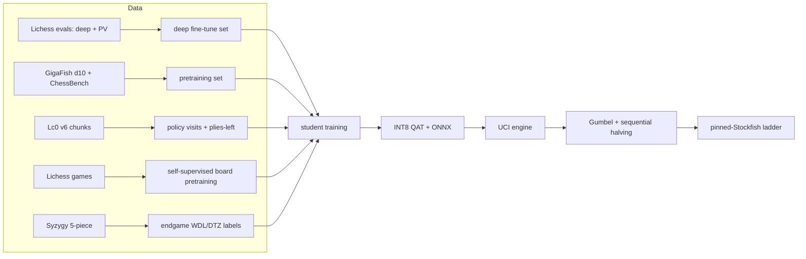
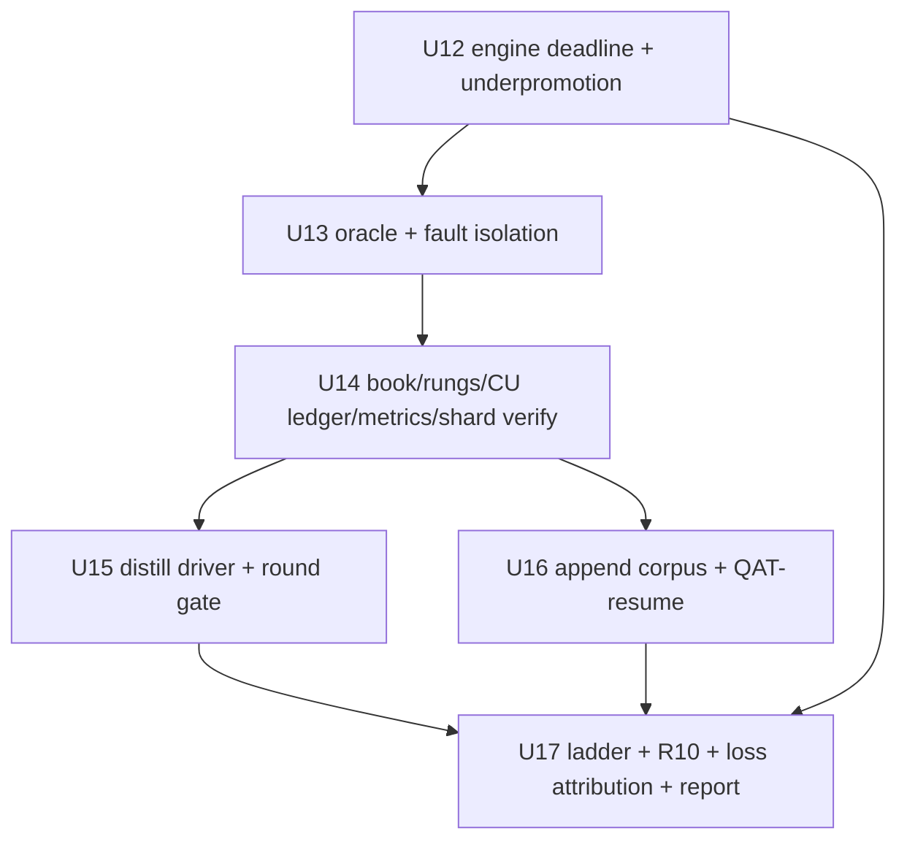

# feat: Distilled chess transformer for bullet play

## Goal Capsule

- **Objective:** A UCI chess engine backed by a randomly initialized ≤20M-parameter hybrid CNN→Transformer student, distilled from public strong teachers, that wins a 400-game 1+0 match against the L3 pinned Stockfish rung (`UCI_Elo 2400`), stays inside a 110–150 compute-unit (CU) Colab budget, and ships with reproducible Elo, puzzle, and latency numbers.
- **Means:** layered public data (deep Lichess evaluations, GigaFish, ChessBench, Lc0 chunks, Syzygy) → on-policy distillation from BT4/Stockfish → AVI-style value targets → Gumbel search with INT8 inference (KTD1–KTD11).
- **Authority:** this plan; the Product Contract governs behavior, KTDs govern implementation choices. Session-settled directions: chess-native architecture (not an LLM), bounded compute spend, from-scratch student with teachers used only as label sources.
- **Execution profile:** four stacked PRs — measurement/data, student pretraining and export, distillation and match, plus reliability fixes and scaled retraining (cycle 2). The repository is runnable after every merge.
- **Stop conditions:** the 150 CU ceiling is reached; a strength gate fails twice after a documented fix; or L3 is proven unreachable, in which case the highest rung beaten is recorded and the run stops.
- **Finishes the work:** `ce-work` executes the units; the user owns the Colab account and accepts the final rung.

## Execution Status (resumed 2026-11-08, improvement cycle)

- **Cycle 1 complete (negative result):** U1–U11 executed on Colab L4 (`docs/results/2026-11-07-p6m-colab-l4.md`). P6M `deep.pt` (20k value + 30k deep + 3 distill rounds) played 0/3/97 vs L2 — below the floor. Dominant cause: `go movetime` collapsed to ~1 sim/move, so the net's raw policy played the whole match. Net also undertrained (policy loss ~1.3, high PV loss from zero-initialized PV heads — fixed in cycle-1 review).
- **Cycle-1 review fixes landed:** movetime→budget mapping, PV head initialization, SSL device, gate bands, PV gate, plus a `throughput` bf16 revert (`1838ef8`, `bf2e582`).
- **Measured on L4** (torch 2.14.1+cu130): P6M 4460 pos/s, 12.9 ms FP32 batch-1; P20M 2089 pos/s, 35.6 ms; training ~1.5–1.9k pos/s staged. ~9 CU spent of 260; ~250 CU remain — cycle 2 runs inside the unchanged 110–150 CU band.
- **Cycle 2 (this plan adds U12–U17):** land the residual reliability fixes (wall-clock deadline, oracle hardening, rung/fault handling, cumulative CU), write the distill-round driver that cycle 1 ran ad hoc, scale the P6M student's data and training budget, then re-run the ladder + R10 and report. Fixes land before any re-evaluation (KTD12, KTD13).
- **Budget (cumulative):** the 110–150 CU band is total-spend, not per-cycle — ~9 CU already consumed leaves ~141 CU ceiling for cycle 2 (the ledger U14 adds reports cumulative vs. band).
- **Match preset rule (unchanged):** P6M remains the match preset — FP16 batch-1 ~9.8 ms projected INT8 fits 32 sims in 400 ms; P20M cannot. R3 binding is still the user's call (Deferred).
- **Settled (cycle 1):** GPU/match execution runs on Colab via the `colab` CLI (session-settled: user-directed — the budget contract is denominated in Colab CU).


---

## Product Contract

### Summary

Train a small, fast chess network from random initialization by distilling the strongest public teachers into it, then give it thousands of search simulations per bullet move instead of a few. The plan optimizes Elo per compute unit at 1+0, not parameter count.

### Problem Frame

The earlier version of this plan targeted a 20M policy-only net around 2,600 engine-pool Elo, which is not competitive. Two findings changed the design. First, search dominates: the efficient-self-play study measured ~81 Elo per doubling of visits, and its 6.32M net reached 3,251 at 100k simulations and 2,823 at 1,000. Second, capacity per forward pass is not the constraint at bullet — simulation throughput is. A small net at 20k simulations beats a 191M net at 100.

The data side also changed. Public deep labels now exist: Lichess publishes 416M unique positions with Stockfish evaluations including depth, node count, and principal variation (1.0B rows, CC0), and GigaFish publishes 3.9B positions at depth 10 (CC0). A depth-10 distillation was measured to play at about Stockfish depth 10 — so shallow labels are only a pretraining stage, never the final target.

The result is a teacher→student plan: the student is trained from scratch, but its labels come from teachers far stronger than anything this budget could train.

### Requirements

**Model and engine**

- R1. The student is initialized from random weights; teachers (BT5, Stockfish, Lichess evaluations) supply labels only and are never loaded as starting weights.
- R2. The student is a hybrid CNN stem plus square-token transformer with at most 20M parameters and no autoregressive move decoding.
- R3. One policy-only evaluation runs in ≤10ms on an L4 at batch 1, and the engine spends at most 400ms per move on average over a 1+0 game, reserving time for the endgame.
- R4. At inference the engine uses Gumbel search with sequential halving, adaptive simulation counts driven by value-head uncertainty, and INT8 quantized inference.

**Data and budget**

- R5. All training data comes from public sources: Lichess evaluations (CC0), GigaFish (CC0), ChessBench (CC-BY), Lc0 training chunks, Lichess games/puzzles, Syzygy 5-piece, and TCEC/CCC archives.
- R6. The final student is never trained on labels shallower than depth 20; depth-10 data is used only for the pretraining stage.
- R7. Total Colab spend stays within a 110–150 CU band: 110 CU is the planning target, 150 CU is the hard ceiling. A guard refuses a run that would exceed the ceiling, the phase allocation, or the remaining balance minus a 5 CU reserve.
- R8. Any training run resumes from its last checkpoint after a VM loss with at most 15 minutes of lost progress.

**Strength and reporting**

- R9. The engine beats the L3 rung (Stockfish `UCI_Elo 2400`, `UCI_LimitStrength=true`) in a 1+0 match of at least 400 games with a 95% interval excluding 50%. L2 (`UCI_Elo 2000`) is the minimum delivery floor, N10k (10k nodes/move) is the stretch, and a sub-floor result is reported as a negative result.
- R10. The engine beats at least one non-Stockfish open-source engine in the same protocol.
- R11. The final report states the exact match specification (engine build, nodes or time, threads, time control, book, tablebase path) and Elo with intervals, plus puzzle accuracy, policy agreement, latency, and achieved simulations.
- R12. One command rebuilds the training cache and one command runs the evaluation ladder from a clean checkout.
- R13. On-policy and AVI labels keep the teacher-quality floor the plan sets (Stockfish depth 22–24 / BT4 64 sims): R6's depth-20 rule binds the deep-label corpus, while oracle labels carry their own stated budgets so no sim↔depth equivalence is invented.

### Success Criteria

- A user can install the package, start the UCI engine, and play a legal bullet game in any UCI GUI.
- The match log and Elo table reproduce from the committed evaluation script on the committed checkpoints.
- Puzzle accuracy, policy agreement, latency, simulations per move, and Elo are all reported for the same checkpoint.

### Scope Boundaries

**Deferred to follow-up work**

- Fine-tuning BT5 directly as an alternative arm.
- Looped/depth-recurrent student, mixture-of-depths routing, test-time training layers.
- 6-piece and 7-piece Syzygy.
- LFM3 or other language-model backbones.
- Multi-GPU training and larger presets (50M+).

**Outside this product's identity**

- Full-strength Stockfish at classical time controls.
- Chess960 and other variants.
- A web product, GUI, or commercial distribution.
- Solving chess; the plan targets a documented rung ladder.

### Key Decisions

- **KD1. Chess-native hybrid encoder, not an LLM.** ResNet stem feeds square tokens; the model is not a tokenized-FEN decoder. (session-settled: user-directed — chosen over post-training LFM3-1.7B: the user rejected the LLM backbone.) Governs R2.
- **KD2. 110–150 CU budget band.** 110 CU is the planning target and 150 CU the ceiling, chosen over spending the full 261.83 CU balance so other projects keep their allowance. (session-settled: user-directed — chosen over an unconstrained cloud budget.) Governs R7.
- **KD3. From-scratch student with teacher labels.** Chosen over fine-tuning BT5 directly: at bullet the binding resource is simulations, and a 6–20M student buys 10–30× more of them. Teachers are label sources, preserving the from-scratch training pipeline. (session-settled: user-directed — chosen over warm-starting the engine from a released checkpoint.) Governs R1.
- **KD4. Pinned rungs, not an open-ended "beat Stockfish".** Chosen because Stockfish strength is a function of nodes and threads, so an unpinned target cannot be verified. Governs R9, R11.
- **KD5. Deep labels only for the final student.** Chosen because depth-10 distillation was measured to cap play near depth 10. Governs R6.

### Sources / Research

| Source | What it establishes |
|---|---|
| Braun, *Engineering Efficient Self-Play Chess* (arXiv 2609.37447, 2026) | 6.32M net from random init reaches 3,251 at 100k sims, 1,658 policy-only; ~81 Elo per doubling of visits; INT8+TensorRT 1.31× over FP16; fast/full search, adaptive allocation, graph search, and caching all failed |
| Boige et al., *Approximate Value Iteration in Self-Play* (arXiv 2609.09094, 2026) | One-step negamax value learning beats AlphaZero's value accuracy at far lower cost; those values improve MCTS |
| Monroe et al., *Chessformer* (arXiv 2605.19091, 2026) | Smolgen GAB worth ~83 Elo and 60% compute; head depth 8 and FFN 1× suffice; square-token architecture |
| Lc0 *Transformer Progress* blog (2024) | BT4 191.3M / 7.6 GFLOP; raw policy +270 Elo over T78; architecture and input details |
| Lc0 best-nets page + BT5 registry | BT5-1024x15x32h-rpe adds relative position encoding; INT8 ONNX builds exist |
| Salamone, *Distilling Stockfish with One Billion Positions* (2026) | Gigafish 3.9B depth-10 set; hybrid ResNet→Transformer beats pure ViT at 40–80M; depth-10 distillation plays at depth-10 level |
| Lichess evaluation dataset card | 416M unique positions / 1.0B rows, CC0, fields `fen`, `line`, `depth`, `knodes`, `cp`, `mate` |
| Miłosz et al., *Prior-Directed Exploration* (arXiv 2608.27757, 2026) | Puzzle-only tuning costs 258 Elo; forward-KL prior beats entropy bonus; self-play RL adds only ~16 Elo to a distilled net |
| Danihelka et al., *Gumbel AlphaZero*; MiniZero (arXiv 2310.11305) | Sequential-halving policy improvement at 2–4 simulations |
| Jones, *Scaling Scaling Laws with Board Games* (arXiv 2104.03113) | ~500 Elo per order of training compute; train-time and test-time compute trade off |
| Lc0 training-data format v6 | Policy visits, Q/D/M, plies-left targets per position |

---

## Planning Contract

### Key Technical Decisions

- KTD1. **Hybrid student, not a pure transformer.** ResNet stem over 12 piece planes plus meta planes, then 64 square tokens through smolgen attention. The Gigafish experiments measured pure ViT losing to this hybrid at 40M and 80M; at 6–20M the gap should widen. Presets: P6M and P20M.
- KTD2. **Layered data with depth discipline.** Self-supervised board pretraining on Lichess games; value pretraining on GigaFish depth 10 and ChessBench state values; deep fine-tune on Lichess evaluations filtered to `depth ≥ 24` or `knodes ≥ 100k`; Lc0 v6 chunks for policy visits and `plies_left`.
- KTD3. **PV heads from free data.** The Lichess evaluation rows carry `line` (principal variation). Six auxiliary heads predict the next six plies, giving multi-token lookahead without generating anything.
- KTD4. **AVI-style value targets.** For each sampled position, evaluate legal successors with the teacher and train `max(−V)`; one-step negamax produces more accurate values than MCTS-generated targets at lower cost.
- KTD5. **Gumbel search with sequential halving.** Guaranteed policy improvement at low simulation counts, where PUCT plateaus. Sims scale with measured sims-per-ms within the 400ms budget — floor 32 at the match preset (KTD21 states the honest ~30–40 operating point; the published 1k–100k sim anchors are external reference points, not the plan's range).
- KTD6. **INT8 QAT and ONNX/TensorRT.** Quantisation-aware training plus an exported inference graph; every doubling of evaluations is ~81 Elo, so this is a strength feature.
- KTD7. **On-policy distillation rounds.** The student plays; the teacher labels the positions the student actually reaches; the student is retrained. Three rounds, gated by match score.
- KTD8. **Opening book.** Polyglot book built from TCEC/CCC and Lc0 games, capped at 10–12 plies, used in match play and for opening diversity.
- KTD9. **Syzygy 5-piece.** ~939MB fits the VM disk; used to probe endgames and to supply perfect WDL/DTZ labels for an endgame curriculum. 6-piece (150GB) and 7-piece (18TB) are out.
- KTD10. **Match strength is the only acceptance metric.** Loss, puzzle accuracy, and policy agreement are diagnostics; they cannot ship a checkpoint on their own.
- KTD11. **Prior-directed regulariser, not puzzle RL.** Forward-KL to the teacher's prior during any self-play stage; puzzle reward only as a small auxiliary signal with a Stockfish near-equal-move check.
- KTD12. **Wall-clock deadlines govern every simulated budget.** Simulation counts derived from `movetime`/clock are targets, not guarantees: the search loop checks elapsed wall-clock each iteration and the engine never returns late. Cycle 1 proved sim-count mapping is fragile — this makes lateness impossible regardless of mapping.
- KTD13. **Reliability fixes precede any cycle-2 evaluation or training.** The ladder is only re-run after engine/oracle fixes land; otherwise strength changes are confounded by the same measurement bugs that produced cycle 1's number.
- KTD14. **Scale P6M, not P20M.** The improvement is bought with data and steps at the same preset (more deep-label shards, longer deep stage, more distill rounds at higher sims). P20M stays out: its batch-1 latency cannot fit 32 sims in the 400ms budget (match-preset rule), and ~81 Elo/visit-doubling is the cheaper axis.
- KTD15. **Sim count is a verification input, not an assumption.** The cycle-2 report records achieved sims/move from search telemetry; the eval is invalid below the protocol's sim floor.
- KTD16. **"Train longer" = continue P6M `deep.pt` on an appended corpus.** One run, one preset: `--init deep.pt` (old weights, fresh optimizer at step 0) against the enlarged deep set. Not a warm resume — the corpus changes, so step offsets and the cosine schedule reset deliberately. (session-settled: user-directed — "improve" the same student, not retrain or switch presets.)
- KTD17. **QAT stays simulated; "INT8" means the torch export path.** The ONNX graph is FP-only today and TensorRT-INT8 needs a calibrator that does not exist. Cycle-2 acceptance: QAT-fake-quant checkpoint + `quant.verify` agreement ≥0.99 + ONNX-FP export executed against PyTorch for move agreement. Building a real INT8/TensorRT artifact is deferred — it cannot fit inside the CU band with the rest of the cycle.
- KTD18. **Sims = `budget_ms` × measured sims-per-ms.** `ModelEngine` calibrates sim throughput at startup and again at match start (KTD24), converts the clock budget to a simulation target, and the wall-clock deadline (KTD12) makes it a ceiling, not an override. The ladder asserts median achieved sims ≥ floor from PGN `info nodes` (KTD15).
- KTD19. **Loss attribution is measured, not impressionistic.** `eval/report.py` replays student losses through the existing Stockfish oracle and counts oracle-flagged blunders by ply bucket (opening/tactics/endgame), so "still undertrained" is distinguishable from "regressed" in the report — an inline pass, not a new script.
- KTD20. **R10 opponent re-pinned to an attainable non-Stockfish rung.** Koivisto 9.0 (~3300, structurally unwinnable at these sims) is replaced by Maia-3 1900 — or the strongest non-Stockfish pinned binary fitting the ~1 CU match cost at execution. A pinned Stockfish cannot satisfy R10.
- KTD21. **The cycle-2 operating point is ~30 sims, not the anchors' 1k+.** At ~1 eval/sim and ~10–13ms/eval, the 400ms budget buys ~30 sims — 30× below the lowest published anchor (2,823 @ 1k). L3 (SF-2400) remains the target but the honest expectation at this operating point is L2-adjacent strength; the engine's real lever is batched leaf evaluation (U12), which multiplies evals per sim budget before any weights improve. The report frames the result against achieved sims, not the 1k-sim anchors.
- KTD22. **The cycle-2 ladder runs the real 1+0 protocol.** `go wtime/btime` with a ~400ms/move average (R9), not `--movetime 50` — a 50ms cap allows ~4 sims and invalidates the eval. `--movetime` exists for smoke coverage only.
- KTD23. **A post-fix baseline match precedes the scaled retrain.** A 100-game L2 match on the repaired engine with the pre-U16 checkpoint separates the fix effect from the training effect; otherwise a cycle-2 number cannot attribute improvement.
- KTD24. **Per-sim calibration, not per-eval.** The startup probe runs the real search loop on a fixed position (~50ms) and counts completed sims; `sims_per_ms` then includes tree overhead that raw eval timing misses. On a shared VM the probe re-runs at match start; the lower of the two readings sizes the budget.

- KTD25. **`deep.pt` persistence is a U16 precondition.** The continue-in-place path (KTD16) needs the cycle-1 checkpoint off the ephemeral VM. U16's first step checks for `deep.pt` locally or on the VM; if absent, the unit re-uploads from wherever cycle 1 saved it or falls back to the recorded restart path (reported, not silent).

### High-Level Technical Design



```mermaid
flowchart TB
  P[Via P6M recipe check] --> Q[Student pretrain (match preset P6M)]
  Q --> R[Deep-label fine-tune]
  R --> S[On-policy round 1]
  S --> T[On-policy round 2]
  T --> U[On-policy round 3]
  U --> V[QAT + export]
  V --> W{beat L2?}
  W -->|yes| X{beat L3?}
  W -->|no| Y[record floor, stop]
  X -->|yes| Z[attempt N10k]
  X -->|no| Y2[report L3 reached]
```

Cycle-2 ordering (fixes gate everything; scale and eval run in that order):



### Assumptions

- The Colab account keeps its balance and L4/G4 entitlements; H100 stays unavailable.
- The Lichess evaluation dataset yields enough rows at depth ≥24 to fine-tune; U2 measures the surviving count before U6 launches.
- The `BT4-1024x15x32h-swa-6315000.pb.gz` teacher runs under Lc0 with CUDA on an L4 within memory limits and can be driven through UCI for labeling (BT5 absent from the contrib index — the deferred entry names it).
- Gumbel search at the attainable sim count within 400ms (floor 32, honest ~30–40 at FP — KTD21) once batched-leaf throughput is measured; the engine ships at the highest attainable count and reports it.
- A 6–20M distilled student lands in the 3,000–3,300 engine-Elo band based on the efficient-self-play and Chessformer anchors.

### Dependencies / Prerequisites

- `uv`, Python 3.11+, `torch` 2.x with CUDA, `python-chess`, `fastchess`, a built Stockfish, `lc0` (CUDA build), and the `BT4-1024x15x32h-swa-6315000.pb.gz` weights file.
- Hugging Face account and token for datasets and checkpoint storage; Colab disk for caches.
- Syzygy 3–4–5-piece set (~939MB) and a Polyglot book builder.

### Risks

| Risk | Mitigation |
|---|---|
| Deep Lichess rows are sparse | U2 counts depth ≥24 rows first; fall back to re-labeling a sampled subset with Stockfish at depth 22–24 |
| BT5 labeling is slower than estimated | Label 50k positions per round at 64 sims; the projection gate refuses a round that does not fit its CU line |
| INT8 QAT loses accuracy | QAT folded into the fine-tune stage, not applied post-hoc to a frozen checkpoint; export verification against FP16 on 5k positions |
| Hybrid student underperforms pure transformer | U4 ablates both heads-on at 6M before the main run |
| Gumbel does not beat PUCT at the measured budget | A/B gate; PUCT remains the fallback and the report states which shipped |
| Search cannot fit 400ms | Adaptive simulation count with a floor; ship at the attainable count and report it |
| Book or tablebase introduces bugs | Both behind switches; matches run with and without to attribute any change |

### Alternatives Considered

- **Fine-tune BT5 directly.** Rejected as the main path: at 400ms BT5 gets hundreds of simulations, while a 6–20M student gets thousands; the scaling evidence favors simulation count at bullet. Kept as a deferred arm.
- **Continue a released ChessBench checkpoint.** Rejected: decoder-only token models, contradicting the encoder direction; conversion cost with no pipeline benefit.
- **Pure square-token transformer.** Rejected for the student after the Gigafish evidence that hybrid beats pure ViT at small scale; retained as the ablation arm.
- **AlphaZero self-play from scratch.** Rejected on compute; the budget is smaller than one meaningful self-play run.
- **Retrain P20M from scratch.** Rejected for cycle 2 (KTD14): batch-1 latency cannot fit 32 sims in the 400ms budget, and a new run pays the full pretraining cost again. P20M remains available for a later cycle whose eval runs on INT8+TensorRT.
- **Restart P6M from scratch on the enlarged corpus.** Rejected as wasteful: `deep.pt`'s 50k steps are reusable weights, and the corpus change appends (KTD16). Kept as the fallback if continuing produces a loss regression at the stage gate.

---
### Unit Index

| U | Unit | Files (primary) | Depends on |
|---|---|---|---|
| U1 | Scaffold, config, budget guard | `config.py`, `budget.py` | — |
| U2 | Dataset loaders, depth filter, cache | `data/*` | U1 |
| U3 | Tournament harness, ladder, calibration | `eval/*` | U1 |
| U4 | Hybrid student model + heads | `model/*` | U1,U2 |
| U5 | Training loop, throughput, resume | `train/*` | U2,U4 |
| U6 | Pretraining + deep-label fine-tune | `train/pretrain.py` | U2,U3,U5 |
| U7 | INT8 QAT + ONNX/TensorRT export | `quant/*` | U4,U6 |
| U8 | UCI engine: policy, Gumbel, book, TB | `engine/*` | U4,U6,U7 |
| U9 | Teacher labeling pipeline + AVI | `teacher/*`, `distill/*` | U2,U8 |
| U10 | On-policy distill rounds + prior-KL | `distill/*` | U6,U9 |
| U11 | Ladder + final report | `eval/report.py` | U3,U8,U10 |
| U12 | Engine: wall-clock deadline + underpromotion | `engine/gumbel.py`, `engine/model_engine.py` | U8 |
| U13 | Oracle hardening + fault isolation | `teacher/*`, `eval/tournament.py` | U12 |
| U14 | Eval/budget correctness (book, rungs, CU ledger, metrics, shard verify) | `eval/ladder.py`, `budget.py`, `data/build_cache.py` | U3 |
| U15 | Distill driver CLI + round gate + reanalysis | `distill/rounds.py`, `train/loop.py`, `train/checkpoint.py` | U9,U12,U14 |
| U16 | Scale student: append corpus + QAT-resume + continue deep | `data/build_cache.py`, `train/pretrain.py`, `train/checkpoint.py` | U9,U14 |
| U17 | Cycle-2 eval: ladder+R10, loss attribution, report | `eval/*` | U12–U16 |

## Implementation Units

### PR1: Data and measurement

### U1. Project scaffold, dependency pinning, phase budget guard

- **Goal:** A runnable package whose every command is configuration-driven and whose spend is bounded before work starts.
- **Requirements:** R7, R8, R12
- **Dependencies:** none
- **Files:** `pyproject.toml`, `README.md`, `src/chessfoundation/__init__.py`, `src/chessfoundation/config.py`, `src/chessfoundation/budget.py`, `tests/test_config.py`, `tests/test_budget.py`
- **Approach:**
  - Typed config dataclasses for datasets, presets (P6M/P20M), training stages, and run phases; unknown fields fail loudly.
  - The guard reads `colab usage`, maps accel/rate (L4 1.94, A100 8.67, G4 10.05 CU/h), and refuses a run exceeding `min(150 CU, remaining) − 5 CU reserve` or its phase allocation. The 110 CU planning target only affects projections, not refusals.
  - Every run writes a manifest (config hash, git revision, accelerator, phase, projected CU) before step one.
  - `pyproject.toml` declares the engine console entry point; `README.md` documents install and a first game.
- **Patterns to follow:** `searchless_chess` dataclass configs; `lc0` flag naming for engine options.
- **Test scenarios:**
  - Unknown preset or stage name raises a field-level error.
  - Guard refuses a 6-hour L4 run when `remaining − reserve` is below the projection.
  - Guard refuses a run whose projection exceeds its phase allocation even when the total balance is sufficient.
  - Guard allows the run when both checks pass and records the projection.
  - Clean-venv install exposes the entry point and completes a UCI handshake.
- **Verification:** `pytest` passes; dry-run prints projected CU without starting a VM.

### U2. Dataset loaders, depth filtering, and cache

- **Goal:** Reproducible access to every data source, with the depth discipline encoded once.
- **Requirements:** R5, R6, R12
- **Dependencies:** U1
- **Files:** `src/chessfoundation/data/lichess_evals.py`, `src/chessfoundation/data/gigafish.py`, `src/chessfoundation/data/chessbench.py`, `src/chessfoundation/data/lc0_chunks.py`, `src/chessfoundation/data/lc0_games.py`, `src/chessfoundation/data/puzzles.py`, `src/chessfoundation/data/syzygy.py`, `src/chessfoundation/data/encode.py`, `src/chessfoundation/data/build_cache.py`, `tests/test_encode.py`, `tests/test_cache.py`, `tests/test_sources.py`
- **Approach:**
  - Streaming readers for HF parquet (`Lichess/chess-position-evaluations`, `lukesalamone/gigafish-3.8b-d10`, ChessBench shards) that never materialize a full dataset.
  - Depth policy: rows with `depth ≥ 24` or `knodes ≥ 100_000` go to the deep set; depth-10 rows go to the pretraining set; a count report is emitted per source so the deep-set size is known before U6.
  - Encode each position once to the compact record (32B piece codes, 2B metadata, top-8 policy target, WDL, PV continuation of 6 plies) and write fixed-size shards with checksums.
  - PV extraction from the Lichess `line` field into the six auxiliary targets; illegal or truncated lines are dropped.
  - Lc0 v6 chunk reader for `probabilities[1858]`, `best_q`, `root_q`, `plies_left`; Syzygy reader for 5-piece WDL/DTZ labels.
  - Puzzle ingestion: Lichess DB split by puzzle ID, rating 1200–2200, solution ≤3, disjoint from the eval set.
- **Execution note:** Validate the encoder against `python-chess` move generation and confirm PV round-trips before training; a silent offset would be invisible in loss.
- **Test scenarios:**
  - Start position and a castling/en-passant/promotion position round-trip through the encoder.
  - A depth-23 position is excluded from the deep set and included in pretraining; a `knodes ≥ 100k` position at depth 23 is included in the deep set.
  - A PV line of six plies yields six targets; a line containing an illegal move is dropped entirely.
  - Lc0 v6 record decodes to a policy distribution summing to 1 and a finite `plies_left`.
  - Two cache builds produce identical checksums.
  - Source count report lists unique positions per depth band.
- **Verification:** Cache build prints per-source counts and checksums; spot-check replays 1000 cached records through `python-chess`.

### U3. Tournament harness, ladder, and calibration

- **Goal:** A measurement rig that plays any UCI engine against any other and produces Elo with intervals.
- **Requirements:** R9, R10, R11
- **Dependencies:** U1
- **Files:** `src/chessfoundation/engine/uci.py`, `src/chessfoundation/eval/tournament.py`, `src/chessfoundation/eval/ladder.py`, `src/chessfoundation/eval/puzzles.py`, `tests/test_uci.py`, `tests/test_tournament.py`, `tests/test_ladder.py`
- **Approach:**
  - fastchess runs the games; this unit generates its configuration (engine paths, threads, time control, book, concurrency, game count) and parses PGN plus rating output. Elo and intervals have one producer.
  - Rungs pin `UCI_LimitStrength=true`, `Threads`, `Hash`, and the option readback; a rung that ignores the limit fails validation instead of playing full strength.
  - Ladder climbs while the score interval excludes 50% with the engine ahead; a sub-floor result is recorded, not hidden.
  - Calibration: each candidate rung plays Maia-3 5M on the same pool so rung strength is expressed in a comparable unit.
- **Test scenarios:**
  - Stub engine completes the handshake and returns a legal move.
  - A 60/40 synthetic result yields the expected Elo and interval; 51% over 400 games does not exclude 50%.
  - A rung config missing `UCI_LimitStrength` fails validation.
  - Ladder stops when the interval includes 50% and climbs when it excludes it.
  - Calibration match writes the reference result alongside the rung result.
- **Verification:** A 20-game smoke match writes a PGN and a parsed rating line.

### PR2: Student model and pretraining

**Waits on:** PR1 (merge order only; cache and harness interfaces are consumed directly).

### U4. Hybrid student model and heads

- **Goal:** The network that turns a board into a move distribution, a value, a PV, and a moves-left estimate.
- **Requirements:** R1, R2, R3
- **Dependencies:** U1, U2
- **Files:** `src/chessfoundation/model/stem.py`, `src/chessfoundation/model/smolgen.py`, `src/chessfoundation/model/student.py`, `src/chessfoundation/model/heads.py`, `src/chessfoundation/model/presets.py`, `tests/test_model.py`
- **Approach:**
  - ResNet stem over 12 piece planes plus meta planes, flattened into 64 square tokens; smolgen attention with head depth 8; FFN 1×; RMSNorm; no QKV bias.
  - Heads: source→destination policy with promotion bias and legal masking; WDL value; six PV heads; moves-left regression (auxiliary, dropped at inference).
  - P6M (d=256, 8 transformer blocks) and P20M (d=384, 12 blocks) presets with parameter-drift tests.
  - An ablation switch for pure-transformer vs hybrid, used once at 6M.
- **Patterns to follow:** `CSSLab/maia-chess` for smolgen shapes; Gigafish hybrid ordering (ResNet → Transformer).
- **Test scenarios:**
  - Forward pass returns 64×64 policy logits, a 3-way WDL distribution summing to 1, six PV distributions, and a finite moves-left value.
  - Illegal moves are masked to zero probability.
  - Promotions expose all four pieces.
  - Presets land within 5% of their parameter targets.
  - Hybrid and pure-transformer variants instantiate under the same preset name.
- **Verification:** Forward pass under 10ms per position on an L4 at batch 1 for P20M.

### U5. Training loop, throughput, latency, and resume

- **Goal:** A loop that is measurably fast, resumable, and honest about cost before a long run.
- **Requirements:** R3, R7, R8
- **Dependencies:** U2, U4
- **Files:** `src/chessfoundation/train/loop.py`, `src/chessfoundation/train/throughput.py`, `src/chessfoundation/train/checkpoint.py`, `tests/test_loop.py`, `tests/test_resume.py`
- **Approach:**
  - bf16, `torch.compile`, fused AdamW, memmap dataset, static shapes; WSD schedule with warmup for stable resume.
  - Throughput benchmark reports positions/s and games/s per preset and accelerator, converts to CU, and measures policy-only and batched-leaf latency on a randomly initialized P20M.
  - Checkpoints store model, optimizer, scheduler, and data offset; resume restores all four.
  - Short overfit run is the correctness check.
- **Test scenarios:**
  - 100-step overfit on 1000 cached positions drives policy loss well below its initial value.
  - Save at step 50, resume, reproduce the exact next-step loss.
  - Resume after a simulated crash repeats no batch and skips none.
  - Benchmark reports nonzero positions/s, latency, and a CU projection consistent with the rate table.
- **Verification:** Benchmark projects the main run inside its phase allocation; resume test passes.

### U6. Pretraining and deep-label fine-tune

- **Goal:** A base student that predicts deep teacher values, policies, and PVs before any on-policy round.
- **Requirements:** R5, R6
- **Dependencies:** U2, U3, U5
- **Files:** `src/chessfoundation/train/pretrain.py`, `src/chessfoundation/train/gates.py`, `tests/test_gates.py`
- **Approach:**
  - Stage A: self-supervised board pretraining on Lichess games (masked latent prediction).
  - Stage B: value pretraining on GigaFish d10 plus ChessBench state values.
  - Stage C: deep fine-tune on the depth ≥24 Lichess set with policy, WDL, six PV heads, and moves-left.
  - Gate after each stage: policy accuracy against the teacher's top move, value MAE, and PV first-move accuracy must improve; the next stage launches only if its projection fits.
- **Test scenarios:**
  - Gate rejects a checkpoint whose value MAE regresses.
  - Gate refuses to launch stage C when its projection exceeds the phase allocation.
  - Stage C never reads depth-10 rows.
  - Checkpoint upload failure marks the run degraded without losing the local file.
- **Verification:** Stage C improves PV first-move accuracy and value MAE over stage B; the manifest records each stage's scores.

### U7. INT8 QAT and ONNX/TensorRT export

- **Goal:** A quantized inference graph that is measurably faster and provably close to FP16.
- **Requirements:** R4, R11
- **Dependencies:** U4, U6
- **Files:** `src/chessfoundation/quant/qat.py`, `src/chessfoundation/quant/export.py`, `src/chessfoundation/quant/verify.py`, `tests/test_quant.py`
- **Approach:**
  - QAT from the last fine-tune stage; observers on weights and activations; export to ONNX and build a TensorRT engine.
  - Verification evaluates 5,000 held-out positions on FP16 and INT8 and reports move agreement, value MAE, and latency.
  - The export drops PV and moves-left heads; the backbone keeps what they taught.
- **Test scenarios:**
  - INT8 and FP16 agree on ≥99% of argmax moves on the verification set.
  - Value MAE difference is below the configured tolerance.
  - Export fails loudly if the ONNX graph produces a different shape than the PyTorch model.
  - Latency is measured and recorded for both precisions.
- **Verification:** INT8 latency is measurably lower and accuracy within tolerance; numbers land in the manifest.

### U8. UCI engine: policy-only, Gumbel search, book, tablebases

- **Goal:** A playable engine with real search, clock management, book, and tablebase probes.
- **Requirements:** R3, R4, R9
- **Dependencies:** U4, U6, U7
- **Files:** `src/chessfoundation/engine/model_engine.py`, `src/chessfoundation/engine/gumbel.py`, `src/chessfoundation/engine/time.py`, `src/chessfoundation/engine/book.py`, `src/chessfoundation/engine/tablebase.py`, `tests/test_engine.py`, `tests/test_search.py`, `tests/test_time.py`
- **Approach:**
  - Policy-only fallback: one forward, legal argmax, hard cap.
  - Gumbel MCTS with sequential halving and batched leaf evaluation; simulations derived from measured throughput, remaining clock, and value-head entropy; floor of 32 simulations inside 400ms.
  - Time manager: average 400ms per move at 1+0, `MoveOverhead` 20–50ms, reserve for the endgame.
  - PUCT selection mode (`--search puct`, sharing the same tree machinery) so the Risks-table A/B gate and documented fallback are runnable; Gumbel remains the default.
  - Polyglot book probe capped at 12 plies; Syzygy probe when piece count ≤5; `SyzygyFastPlay` configurable.
- **Test scenarios:**
  - Handshake and `go` return legal moves for start and promotion positions.
  - Mate-in-one returns the mating move in both modes.
  - `movetime` is respected within margin; simulation count falls when time falls.
  - Book move is legal and within the ply cap; a book-disabled run differs.
  - Syzygy probe returns a winning move in a 4-piece position.
  - Same seed and position produce the same move.
- **Verification:** Policy-only ≤10ms/eval; search fits at least 32 simulations in 400ms and records the achieved count.

### PR3: Distillation and match

**Waits on:** PR2 (needs a base checkpoint and the exported engine).

### U9. Teacher labeling pipeline and AVI targets

- **Goal:** Deep, on-distribution targets produced cheaply enough for repeated rounds.
- **Requirements:** R1, R5, R6
- **Dependencies:** U2, U8
- **Files:** `src/chessfoundation/teacher/lc0_oracle.py`, `src/chessfoundation/teacher/stockfish_oracle.py`, `src/chessfoundation/teacher/avi.py`, `tests/test_oracle.py`, `tests/test_avi.py`
- **Approach:**
  - Lc0 oracle through UCI: load `BT4-1024x15x32h-swa-6315000.pb.gz`, request MultiPV and PV at a fixed node budget (64 sims), parse visit distributions and WDL.
  - Stockfish oracle at depth 22–24 for tactical verification and for re-labeling positions the student reaches.
  - AVI targets: for sampled positions, evaluate legal successors with the oracle and record `max(−V)`; fall back to top-k successors when the oracle rate would blow the CU line.
  - Every labeled position records which oracle, budget, and depth produced it.
- **Test scenarios:**
  - Lc0 oracle returns a visit distribution summing to 1 and a legal best move.
  - Stockfish oracle returns depth and multipv lines; a malformed line fails loudly.
  - AVI target equals the negamax maximum over successor values on a toy 3-ply game.
  - Top-k fallback produces the same target as full enumeration on a position with a dominant move.
- **Verification:** A 100-position labeling run completes, and the recorded oracle budgets match the manifest.

### U10. On-policy distillation rounds and prior-directed update

- **Goal:** Three rounds of student-play → teacher-label → retrain, each improving match strength.
- **Requirements:** R5, R6, R9
- **Dependencies:** U6, U9
- **Files:** `src/chessfoundation/distill/rounds.py`, `src/chessfoundation/distill/prior_kl.py`, `src/chessfoundation/distill/replay.py`, `tests/test_rounds.py`, `tests/test_prior_kl.py`
- **Approach:**
  - Each round: the student plays vs Stockfish at the target rung and vs itself from book openings; positions are labeled by the oracle; AVI targets are computed; the student is retrained on the round set with replay of earlier rounds.
  - Prior-directed regulariser: forward KL to the teacher's prior, replacing entropy bonus; puzzle reward is a small auxiliary term with a Stockfish near-equal-move check.
  - ReZero-style reanalysis: re-label the replay sample with the latest checkpoint before each round.
  - Round gate: the match score against the current rung must improve or hold; otherwise the round is dropped and recorded.
- **Test scenarios:**
  - A round's labeled set contains only positions the student actually reached.
  - Forward KL is zero at initialization against the teacher prior.
  - A round that regresses match score is rejected by the gate.
  - Reanalysis changes targets for positions whose teacher values moved.
  - Puzzle auxiliary cannot dominate the total loss beyond its configured weight.
- **Verification:** Three rounds run end to end; each round's match delta and CU spend are recorded.

### U11. Ladder, calibration, and final report

- **Goal:** A defensible strength claim at a documented rung with reproducible numbers.
- **Requirements:** R9, R10, R11
- **Dependencies:** U3, U8, U10
- **Files:** `src/chessfoundation/eval/report.py`, `docs/results/README.md`, `tests/test_report.py`
- **Approach:**
  - Ladder data: L2 (`UCI_Elo 2000`), L3 (`2400`), N10k (10k nodes/move), full strength; climb on the interval rule.
  - 400-game primary match at 1+0 with the book; policy-only and searched variants both measured on the final rung; stage-C `deep.pt` vs post-distill-round checkpoint delta reported.
  - Opponent set: pinned Stockfish rungs plus one non-Stockfish open-source engine for R10.
  - Report records binaries, options, book, tablebase path, achieved simulations, intervals, puzzle accuracy, and latency.
- **Test scenarios:**
  - Unpinned engine version fails ladder validation.
  - Report lists protocol and interval for every match.
  - SFT and post-RL scores appear for the same protocol.
  - A sub-floor run is reported as a negative result.
- **Verification:** Ladder runs end to end and writes the report.

### PR4: Reliability fixes and scaled retraining (cycle 2)

**Waits on:** PR1–PR3 (already merged). Executes fully before any cycle-2 evaluation.

### U12. Engine: wall-clock deadline + underpromotion + batched leaves

- **Goal:** The engine cannot return late regardless of how clock time maps to sims, every promotion is reachable, and the search evaluates leaves in batches so the 400ms budget buys the sims the anchors assume.
- **Requirements:** R3, R4 (KTD12, KTD18, KTD21, KTD24)
- **Dependencies:** U8
- **Files:** `src/chessfoundation/engine/gumbel.py`, `src/chessfoundation/engine/model_engine.py`, `src/chessfoundation/engine/time.py`, `tests/test_engine.py`
- **Approach:**
  - `search()` captures `time.monotonic()` once; the loop checks the clock every iteration and exits when budget is spent — `budget_ms × measured sims-per-ms` (KTD24) is the cap, the wall clock is the backstop.
  - `ModelEngine` runs a per-sim calibration probe at startup and again at match start (KTD24): the real search loop on a fixed position for ~50ms, count completed sims; `sims_per_ms` converts any `go` budget to a sim target. Lower of the two readings sizes the budget.
  - **Batched leaf evaluation:** pending leaf expansions collect into one batch per iteration instead of one `_evaluate` call per leaf — the mechanism that moves evals/s toward the published anchors' regime (KTD21). Batch size bounded by device memory; fall back to sequential when the batch is one.
  - The `promo` head's 4-way choice is reachable through `_best_move`/`_promotion_choice`: under-promotions (N/B/R) route by promo index rather than folding into the queen-only fallback; gumbel children enumerate under-promotion moves.
  - `throughput.measure` calls `torch.cuda.synchronize()` after the timed loop so CUDA timings are real.
- **Test scenarios:**
  - `search()` with a 50ms deadline on a slow mock model returns a legal move with `elapsed < deadline + eval_cost`.
  - `best_move` with `movetime_ms=50` produces `simulations ≥ 1` and `elapsed ≤ ~2×movetime`.
  - Batched `_evaluate` returns identical results to per-leaf calls on the same board set (batch-of-N vs N singles).
  - `_promotion_choice` returns a knight promotion for a position where only N promotes; search can pick it when it is the best move.
  - A mock model that sleeps 10ms/eval does not run past the deadline even when `simulations` is set high.
- **Verification:** UCI `go movetime 50` returns a legal move in ≤100ms wall-clock; `go wtime 1000 btime 1000` never exceeds the allocated budget; achieved sims > 1; batched search's sims/sec ≥ 2× the unbatched rate on the same position.
### U13. Oracle hardening + fault isolation

- **Goal:** A stalled or crashing teacher/opponent cannot hang the round or forfeit a match mid-run; malformed engine output is a clean error, not a crash or a silent label.
- **Requirements:** R9, R10 (KTD13)
- **Dependencies:** U12
- **Files:** `src/chessfoundation/teacher/lc0_oracle.py`, `src/chessfoundation/eval/tournament.py`, `tests/test_teacher.py`, `tests/test_tournament.py`
- **Approach:**
  - Bound the analyse call itself — `SimpleEngine.analyse` takes no `timeout` kwarg and `engine.timeout` never engages for `Limit(nodes=)`/`Limit(depth=)` calls. Wrap the call in a bounded wait (`asyncio.wait_for`/`concurrent.futures` with `timeout_s`, or add a `Limit(time=timeout_s)` backstop to the nodes/depth limit); a stalled engine raises a typed `OracleTimeout`.
  - Missing/empty `infos`, absent `score`, or `cp`/`mate` edge cases raise `OracleError` with the board FEN attached — labeling skips the position rather than emit a wrong record.
  - `tournament.run_local` catches engine-process exceptions per game, records the game as a forfeit (fault type in the match notes), and continues rather than propagating mid-match.
- **Test scenarios:**
  - A mock engine that sleeps past `timeout_s` raises `OracleTimeout`; a mock returning `{}` infos raises `OracleError` carrying the FEN.
  - `run_local` where the engine dies on game 3 records games 1–2, forfeits 3+ with the fault noted, and returns a `MatchResult`.
  - `label_positions` drops oracle-failed positions and reports the skipped count.
- **Verification:** A 100-position labeling run with a deliberately killed Stockfish completes with skipped positions counted, no traceback.

### U14. Eval/budget correctness: book wiring, nodes rung, CU ledger, metrics, shard verify

- **Goal:** The match protocol the plan specifies (book, pinned rungs, node limits) is the protocol that actually runs; CU spend is cumulative; artifacts and shard integrity are verifiable.
- **Requirements:** R7, R8, R9, R11, R12 (KTD13, KTD18)
- **Dependencies:** U3
- **Files:** `src/chessfoundation/eval/ladder.py`, `src/chessfoundation/eval/tournament.py`, `src/chessfoundation/budget.py`, `src/chessfoundation/data/build_cache.py`, `src/chessfoundation/data/cache.py`, `src/chessfoundation/train/pretrain.py`, `tests/test_ladder.py`, `tests/test_budget.py`, `tests/test_cache.py`
- **Approach:**
  - `ladder --book` plumbs into `MatchConfig` as `openings`; every match game starts from a book position with alternating colours, as KTD8 already specifies.
  - Nodes rungs express as `Limit(nodes=N)` in `run_local`, not a `{"Nodes": N}` option — `Rung.nodes` drives the per-game limit while `uci_elo` rungs keep `UCI_LimitStrength` (fixes the unrunnable N10k rung).
  - `budget` keeps a cumulative `used_cu` ledger (JSON at a stable path): each `check_run` writes the post-run balance, so per-phase and total spend survive VM loss and report accurately.
  - `pretrain --out` writes `<out>.metrics.json` alongside the checkpoint (the file `gates.main` requires), removing the hand-copied step.
  - `ShardDataset` verification treats an unlisted `shard-*.bin` as a failure (stray-file guard); `build()` writes the manifest incrementally after each shard so a mid-build crash leaves a resumable prefix (U16's append path builds on this).
  - `fastchess_command` emits `st={movetime_ms / 1000.0}` (seconds, not milliseconds) or an explicit `tc=` time control — the current code would give each side ~50s/move in a match meant to take ~50ms.
  - `run_local` captures per-move engine info (`engine.play(..., info=INFO_ALL)` or PGN comment annotation) so `info nodes` is recorded — the sims-floor verification (KTD15) reads it from match PGNs.
- **Test scenarios:**
  - `ladder --book book.bin` produces games whose PGN opening lines come from the book, colours alternating.
  - A `nodes=10_000` rung issues `go nodes 10000` on the wire (mock engine records the command) instead of setting a `Nodes` option.
  - Two `check_run` calls accumulate `used_cu` in the ledger; a restart reloads it.
  - `pretrain --out x.pt` also writes `x.metrics.json`; `ShardDataset` rejects a directory containing a shard absent from the manifest.
  - `fastchess_command` emits `st=0.05` (seconds) for a 50ms/move match — a `st=` value interpreted as seconds, not the ms literal.
  - Match PGNs contain per-move node counts (info annotation), readable by the report's sims check.
- **Verification:** A 4-game ladder on a mock book uses book openings; a nodes-rung mock match validates and plays; ledger file exists and survives a second run.

### U15. Distill driver + round gate + reanalysis

- **Goal:** On-policy rounds are a single CLI command end-to-end (play → label → retrain → gate) instead of ad-hoc Colab cells, with the plan's round-improvement gate enforced and replay labels refreshed.
- **Requirements:** R9 (KTD13); completes U10's unfinished wiring
- **Dependencies:** U9, U12, U14
- **Files:** `src/chessfoundation/distill/rounds.py`, `src/chessfoundation/distill/replay.py`, `src/chessfoundation/distill/__main__.py` (the `python -m chessfoundation.distill` entry the contract requires), `src/chessfoundation/train/loop.py`, `src/chessfoundation/train/checkpoint.py`, `tests/test_rounds.py`
- **Approach:**
  - `python -m chessfoundation.distill` (`distill/__main__.py`) wires `play_and_collect` → oracle `analyse` → `label_positions` → `run_round` → save checkpoint; CLI flags for engine paths, sims, games, output dir, replay dirs. The collection loop reuses U13's fault-isolated game loop rather than a second unguarded copy.
  - Positions are collected *with the fixed search* (U12's real sim count, not the 1-sim bug) — cycle-2 labels come from positions the repaired engine reaches.
  - `replay.reanalyse` runs each round: the replay sample is re-labeled with the **external teacher oracle** (Stockfish/BT4 at the stated budgets, matching R13 — not the student checkpoint) before retraining so stale labels don't persist. Labeling cost counts against the `labels`/`distillation` CU allocation.
  - `prior_kl` joins `loop.train`'s loss as the forward-KL regulariser KTD11 specifies (weight from `TrainConfig`, default small).
  - Round gate: the round's match score vs. the current rung must improve or hold vs. the previous round; a regression drops the round checkpoint and records it, per U10.
- **Test scenarios:**
  - `distill` end-to-end on a mock engine produces a shard, a checkpoint, and a round-record JSON.
  - `reanalyse` replaces labels for positions whose teacher value moved.
  - `prior_kl` loss is ≥0 and zero at initialization against the teacher prior.
  - A gated round that regresses match score leaves the previous checkpoint as current.
- **Verification:** One 2-game distill round runs end-to-end on CPU or mock; the driver is the same path Colab runs.

### U16. Scale student: appended corpus, QAT-resume order, continued deep stage

- **Goal:** A larger deep-label corpus built without destroying the existing 160 shards, a resumable QAT stage, and a continued `deep.pt` trained longer on the enlarged set.
- **Requirements:** R5, R6, R7, R8 (KTD14, KTD16, KTD17)
- **Dependencies:** U9, U14
- **Files:** `src/chessfoundation/data/build_cache.py`, `src/chessfoundation/data/cache.py`, `src/chessfoundation/train/pretrain.py`, `src/chessfoundation/train/checkpoint.py`, `tests/test_cache.py`, `tests/test_pretrain.py`
- **Approach:**
  - `build()` gains an append mode: shards continue past the existing max index, the manifest is rewritten covering old + new — no `clear_shards` when appending. U14's incremental manifest writes make a crashed build resumable.
  - `pretrain` applies `prepare_qat` before `load(resume)`, or stores checkpoints unwrapped — whichever is smallest — so a mid-QAT checkpoint resumes. The SSL stage gets the same resume path as the others.
  - Continue training: `--init deep.pt` (weights only, step 0) with `--stage deep` on the enlarged corpus, `--steps` sized to the `pretrain` phase allocation — not `--resume` (KTD16). Order of 30–60k additional steps depending on phase budget and corpus size; the exact count is chosen at execution by `check_run`. `--save-every` is set so worst-case lost work is ≤15 minutes at the measured step rate (≈2,500 steps at ~3 steps/s), satisfying R8.
  - Precondition (KTD25): `deep.pt` must be reachable — check the VM `/content/checkpoints/` first; if absent, re-download/upload it before any corpus work. If unrecoverable, the unit falls back to the recorded restart path and the report states that.
- **Test scenarios:**
  - `build(..., append=True)` with new shards leaves existing shards intact and produces a manifest covering both sets.
  - A checkpoint saved mid-QAT stage `--resume`s successfully (keys match after the ordering fix).
  - `--init deep.pt --stage deep` starts at step 0 and consumes records from the enlarged corpus; `--save-every` writes every N steps.
- **Verification:** Appended cache verifies; a crashed-at-halfway build resumes rather than wipes; QAT-resume round-trips.

### U17. Cycle-2 evaluation: ladder + R10, loss attribution, honest report

- **Goal:** A defensible strength number for the improved student, with achieved sims verified and losses attributed — or an honest negative result.
- **Requirements:** R9, R10, R11 (KTD15, KTD18, KTD19, KTD20)
- **Dependencies:** U12, U13, U14, U15, U16
- **Files:** `src/chessfoundation/eval/ladder.py`, `src/chessfoundation/eval/tournament.py`, `src/chessfoundation/eval/report.py`, `docs/results/README.md`, `tests/test_report.py`
- **Approach:**
  - **Post-fix baseline first (KTD23):** a 100-game L2 match on the repaired engine with the pre-U16 checkpoint runs *before* the scaled retrain completes, so the report separates the fix effect from the training effect.
  - The ladder runs the real R9 protocol (KTD22): `--book` + 1+0 clock (~400ms/move average) with the calibrated engine; `--movetime` is smoke coverage only. The report populates `simulations` from PGN `info nodes` (assert median ≥ floor — KTD15/KTD18).
  - R10 opponent: Maia-3 1900 (KTD20) — replaces Koivisto; no Stockfish proxy.
  - Loss attribution is inline in `eval/report.py`: replay student losses through the existing Stockfish oracle and count oracle-flagged blunders (opening/tactics/endgame via ply buckets) — no separate script (KTD19 sized to the report's own pass).
  - Report records actual sims/move, book usage, opponent binaries/options, CU ledger totals vs the 110–150 band, and the post-fix-baseline vs post-scale delta.
  - If the ladder still loses: stop after one more documented-config run; report highest rung beaten + loss attribution (the "done" rule the spec was missing).
- **Test scenarios:**
  - `render(..., simulations=median)` prints the achieved sims; a PGN whose `info nodes` is missing yields `None`, not a crash.
  - The inline blunder pass on a small PGN produces classification counts.
  - A mock negative-ladder run writes a negative-result report line with attribution.
- **Verification:** Cycle-2 run on Colab produces a results doc with sims verified ≥ floor under the 1+0 protocol; every reported match lists protocol and interval; baseline vs post-scale delta is stated; CU ledger reconciles with `colab usage`.

---

## Verification Contract

| Check | Command or artifact | Exit criterion |
|---|---|---|
| Unit tests | `uv run pytest -q` | all pass |
| Lint | `uv run ruff check .` | clean |
| Install | clean-venv install plus UCI handshake | entry point starts and returns a legal move |
| Cache integrity | `uv run python -m chessfoundation.data.build_cache --verify --out <cache-dir>` | checksums match; deep-set count reported |
| Throughput gate | `uv run python -m chessfoundation.train.throughput --preset p20m --accelerator L4` | projected run ≤ phase allocation; latency recorded |
| Pretrain gate | `uv run python -m chessfoundation.train.gates --checkpoint <path> --data <cache> [--previous <metrics.json>]` | value MAE and PV accuracy improve per stage |
| Quantization | `uv run python -m chessfoundation.quant.verify --reference <fp ckpt> --candidate <qat ckpt> --data <cache>` | ≥99% move agreement; latency lower |
| Engine | `uv run python -m chessfoundation.engine.model_engine --preset p6m` (policy-only) | policy-only latency recorded vs R3 bound; ≥32 sims in 400ms |
| Match | `uv run python -m chessfoundation.eval.ladder --engine <uci> --opponent <uci> --book <book>` | score interval excludes 50% at the claimed rung |
| Budget | `colab usage` before and after each GPU run | cumulative ≤150 CU, per-phase respected, target band 110–150 reported |
| Cycle-2 search clock | `uv run pytest tests/test_engine.py -k deadline` | deadline honored; sims > 1 at movetime 50 |
| Book in match protocol | `ladder --book` on a mock book | PGNs start from book lines, colours alternate |
| Nodes rung | mock `go nodes` wire check | rung validates and plays via `Limit(nodes=)` |
| CU ledger | `budget` ledger file after 2+ runs | cumulative `used_cu` survives restart; reconciles with `colab usage` |
| QAT resume | `pretrain --stage deep --qat --resume <ckpt>` | mid-QAT checkpoint resumes, keys match |
| Distill driver | `python -m chessfoundation.distill` 2-game mock run | shard + checkpoint + round record emitted |
| Sims floor | PGN `info nodes` parse in report | median achieved sims ≥ floor; report prints them |

---

## Definition of Done

- All units complete, tests and lint pass, and cache, checkpoints, and report are committed or linked from `docs/results/README.md`.
- The engine plays a legal bullet game in a UCI GUI, and the ladder result reproduces from the committed configuration.
- Total Colab spend stays within the 110–150 CU band and respects the per-phase allocation; the report states actual spend against the 110 target.
- Failed experiments and scratch notebooks are deleted.
- The report states the achieved rung, the pinned configuration, the achieved simulations, and the gap to the next rung; a sub-L2 result is reported as a negative result.
- Cycle-2 (U12–U17) units complete: engine respects the clock, matches run the specified protocol (book, pinned/node rungs), the distill driver exists, and the improved `deep.pt` is the evaluated checkpoint.
- The cycle-2 report states achieved sims/move from PGN telemetry (not assumed), book usage, opponent binaries/options, and loss attribution; a still-negative ladder reports highest rung beaten and stops after one documented-config retry.
- The cumulative CU ledger reconciles with `colab usage` and stays within the 110–150 CU band.


---

## Deferred / Open Questions

From 2026-11-07 doc review:

- **R3 binding (product decision):** R3's ≤10ms policy-only bound does not name which artifact (FP16 PyTorch vs INT8 export) or preset it applies to. Measured FP16 batch-1 latency is 35.6ms (P20M) and 12.9ms (P6M) — both above the bound as literally written. Execution proceeds per the match-preset rule and records attained latency; whether R3 binds the INT8 export or is re-baselined to measured FP16 remains the user's call.
- **R10 opponent (cycle-2 settled):** Maia-3 1900 or the strongest attainable-pinned binary under ~1 CU (KTD20) — replaces Koivisto 9.0, which was structurally unwinnable at these sims.
- **INT8 (cycle-2 settled):** QAT stays simulated; acceptance is the torch checkpoint + agreement ≥0.99 + ONNX-FP agreement (KTD17). Real INT8/TensorRT is deferred — no calibrator/Q-DQ exists and it cannot fit the CU band with the rest of the cycle.
- **Teacher weights (execution substitution):** the plan names BT5-1024x15x32h-rpe as the lc0 teacher; the lczero `networks-contrib/big-transformers/` index carries no BT5 file — `BT4-1024x15x32h-swa-6315000.pb.gz` (same 1024x15x32 family, latest SWA) is the teacher in use. Report names the actual file; if BT5 appears later it is a drop-in swap.


---

## Appendix: Sizing Notes

| Quantity | Value used in the plan |
|---|---|
| Colab balance at planning time | 261.83 CU |
| L4 / A100 / G4 rate | 1.94 / 8.67 / 10.05 CU per hour |
| Plan allocation | 110 CU target, 150 CU ceiling (data 8, throughput 4, pretrain 45, teacher labeling 12, distillation rounds 10, QAT/export 4, match/search A/B 8, contingency 8 = 99 committed; headroom 51) |
| Cycle-2 allocation (within the same cumulative band) | post-fix baseline ~2, corpus append ~4–6 (data), continued deep ~15–25 (pretrain), distill rounds ~8–10, ladder+R10+attribution ~4–6, contingency ~8 → ~45 CU committed of ~141 remaining |
| Student presets | P6M (d=256, 8 blocks), P20M (d=384, 12 blocks), hybrid stem |
| Teacher | Lc0 BT4 (`BT4-1024x15x32h-swa-6315000.pb.gz`, latest SWA — BT5 absent from the contrib index) at 64 sims; Stockfish depth 22–24 |
| Deep-label filter | `depth ≥ 24` or `knodes ≥ 100k` |
| Pretraining data | GigaFish 3.9B (d10), ChessBench state values; Lichess games for self-supervision |
| Policy/PV data | Lc0 v6 chunks; Lichess eval `line` field |
| Endgame | Syzygy 3–4–5 piece (~939MB) |
| Match protocol | 400 games, 1+0, fixed book, 95% intervals; policy-only ladder and search A/B on Colab L4 |
| Published anchors | Efficient self-play 6.32M: 2,823 @ 1k sims, 3,251 @ 100k; Chessformer 191M policy 2,374; Gigafish hybrid 79M beats pure ViT at 40–80M |
