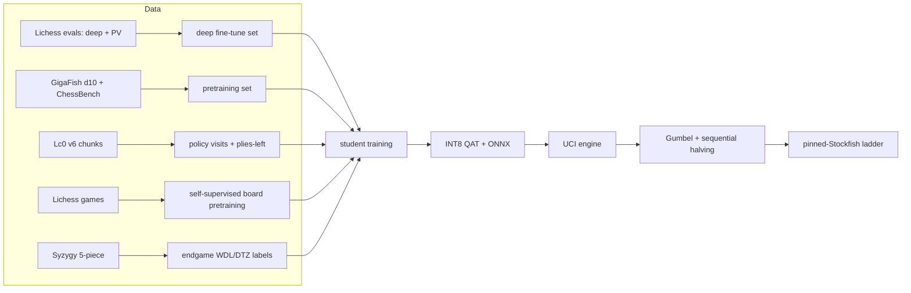
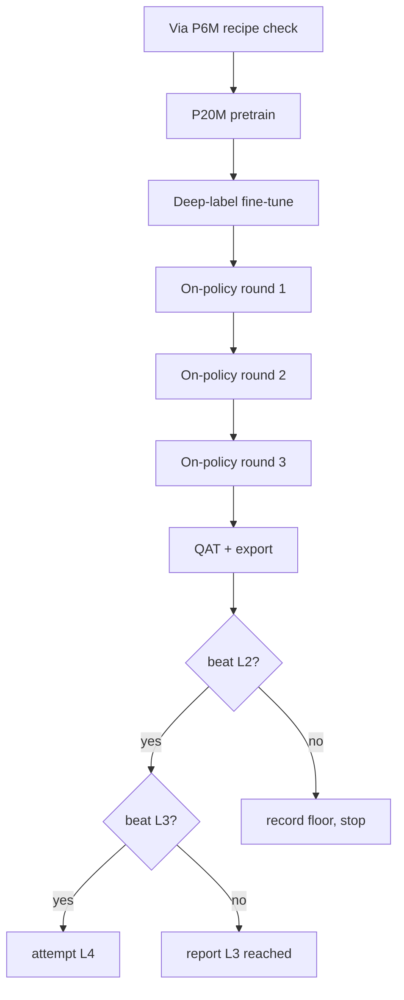

# feat: Distilled chess transformer for bullet play

## Goal Capsule

- **Objective:** A UCI chess engine backed by a randomly initialized ≤20M-parameter hybrid CNN→Transformer student, distilled from public strong teachers, that wins a 400-game 1+0 match against the L3 pinned Stockfish rung (`UCI_Elo 2400`), stays inside a 110–150 compute-unit (CU) Colab budget, and ships with reproducible Elo, puzzle, and latency numbers.
- **Means:** layered public data (deep Lichess evaluations, GigaFish, ChessBench, Lc0 chunks, Syzygy) → on-policy distillation from BT5/Stockfish → AVI-style value targets → Gumbel search with INT8 inference (KTD1–KTD11).
- **Authority:** this plan; the Product Contract governs behavior, KTDs govern implementation choices. Session-settled directions: chess-native architecture (not an LLM), bounded compute spend, from-scratch student with teachers used only as label sources.
- **Execution profile:** three stacked PRs — measurement/data, student pretraining and export, distillation and match. The repository is runnable after every merge.
- **Stop conditions:** the 150 CU ceiling is reached; a strength gate fails twice after a documented fix; or L3 is proven unreachable, in which case the highest rung beaten is recorded and the run stops.
- **Finishes the work:** `ce-work` executes the units; the user owns the Colab account and accepts the final rung.

## Execution Status (resumed 2026-11-07, pipeline run)

- **Done:** U1–U11 code landed and committed; 130 tests pass locally; lint clean. Colab session `bench` (L4) uploaded the package and ran the throughput benchmark.
- **Measured on L4** (`/content/bench.json`, torch 2.14.1+cu130): P6M 4460 pos/s, 12.9ms batch-1; P20M 2089 pos/s, 35.6ms batch-1; training 614 pos/s. P20M batch-1 is above the R3 ≤10ms policy-only target — see Deferred / Open Questions for the unresolved R3 binding decision. The 400ms budget is met via simulation count, not single-eval latency (Assumption on sim counts already anticipates shipping the attainable count).
- **Remaining (execution, not planning):** provision Stockfish/lc0/BT5 + fastchess (or python-chess runner) on Colab; build caches (U2 commands); pretraining stages A→C (U6); QAT/INT8 export verify (U7); engine verification (U8); on-policy rounds (U10); ladder + non-Stockfish match + report (U11); CU accounting against the 110/150 band.
- **Match preset rule:** U6 runs at the largest preset whose FP16 batch-1 latency projects under INT8 (÷1.31 per the plan's INT8 anchor) to fit the 32-simulation floor in 400ms: P6M (12.9ms → ~9.8ms → ~314ms for 32 evals) selected; P20M (35.6ms → ~27ms) cannot reach the floor. Re-confirm at U7 with measured INT8 latency; a P20M export that unexpectedly fits is noted, not retrained.
- **New settled decision:** GPU/match execution runs on Colab via the `colab` CLI with session `bench` (session-settled: user-directed — chosen over local-CPU execution or other clouds: the budget contract is denominated in Colab CU and a live L4 assignment already exists). Governs remaining execution of U5–U11 verification.

---

## Product Contract

### Summary

Train a small, fast chess network from random initialization by distilling the strongest public teachers into it, then give it thousands of search simulations per bullet move instead of a few. The plan optimizes Elo per compute unit at 1+0, not parameter count.

### Problem Frame

The earlier version of this plan targeted a 20M policy-only net around 2,600 engine-pool Elo, which is not competitive. Two findings changed the design. First, search dominates: the efficient-self-play study measured ~81 Elo per doubling of visits, and its 6.32M net reached 3,251 at 100k simulations and 2,823 at 1,000. Second, capacity per forward pass is not the constraint at bullet — simulation throughput is. A small net at 20k simulations beats a 191M net at 100.

The data side also changed. Public deep labels now exist: Lichess publishes 416M unique positions with Stockfish evaluations including depth, node count, and principal variation (1.0B rows, CC0), and GigaFish publishes 3.9B positions at depth 10 (CC0). A depth-10 distillation was measured to play at about Stockfish depth 10 — so shallow labels are only a pretraining stage, never the final target.

The result is a teacher→student plan: the student is trained from scratch, but its labels come from teachers far stronger than anything this budget could train.

### Requirements

**Model and engine**

- R1. The student is initialized from random weights; teachers (BT5, Stockfish, Lichess evaluations) supply labels only and are never loaded as starting weights.
- R2. The student is a hybrid CNN stem plus square-token transformer with at most 20M parameters and no autoregressive move decoding.
- R3. One policy-only evaluation runs in ≤10ms on an L4 at batch 1, and the engine spends at most 400ms per move on average over a 1+0 game, reserving time for the endgame.
- R4. At inference the engine uses Gumbel search with sequential halving, adaptive simulation counts driven by value-head uncertainty, and INT8 quantized inference.

**Data and budget**

- R5. All training data comes from public sources: Lichess evaluations (CC0), GigaFish (CC0), ChessBench (CC-BY), Lc0 training chunks, Lichess games/puzzles, Syzygy 5-piece, and TCEC/CCC archives.
- R6. The final student is never trained on labels shallower than depth 20; depth-10 data is used only for the pretraining stage.
- R7. Total Colab spend stays within a 110–150 CU band: 110 CU is the planning target, 150 CU is the hard ceiling. A guard refuses a run that would exceed the ceiling, the phase allocation, or the remaining balance minus a 5 CU reserve.
- R8. Any training run resumes from its last checkpoint after a VM loss with at most 15 minutes of lost progress.

**Strength and reporting**

- R9. The engine beats the L3 rung (Stockfish `UCI_Elo 2400`, `UCI_LimitStrength=true`) in a 1+0 match of at least 400 games with a 95% interval excluding 50%. L2 (`UCI_Elo 2000`) is the minimum delivery floor, L4 (10k nodes/move) is the stretch, and a sub-floor result is reported as a negative result.
- R10. The engine beats at least one non-Stockfish open-source engine in the same protocol.
- R11. The final report states the exact match specification (engine build, nodes or time, threads, time control, book, tablebase path) and Elo with intervals, plus puzzle accuracy, policy agreement, latency, and achieved simulations.
- R12. One command rebuilds the training cache and one command runs the evaluation ladder from a clean checkout.

### Success Criteria

- A user can install the package, start the UCI engine, and play a legal bullet game in any UCI GUI.
- The match log and Elo table reproduce from the committed evaluation script on the committed checkpoints.
- Puzzle accuracy, policy agreement, latency, simulations per move, and Elo are all reported for the same checkpoint.

### Scope Boundaries

**Deferred to follow-up work**

- Fine-tuning BT5 directly as an alternative arm.
- Looped/depth-recurrent student, mixture-of-depths routing, test-time training layers.
- 6-piece and 7-piece Syzygy.
- LFM3 or other language-model backbones.
- Multi-GPU training and larger presets (50M+).

**Outside this product's identity**

- Full-strength Stockfish at classical time controls.
- Chess960 and other variants.
- A web product, GUI, or commercial distribution.
- Solving chess; the plan targets a documented rung ladder.

### Key Decisions

- **KD1. Chess-native hybrid encoder, not an LLM.** ResNet stem feeds square tokens; the model is not a tokenized-FEN decoder. (session-settled: user-directed — chosen over post-training LFM3-1.7B: the user rejected the LLM backbone.) Governs R2.
- **KD2. 110–150 CU budget band.** 110 CU is the planning target and 150 CU the ceiling, chosen over spending the full 261.83 CU balance so other projects keep their allowance. (session-settled: user-directed — chosen over an unconstrained cloud budget.) Governs R7.
- **KD3. From-scratch student with teacher labels.** Chosen over fine-tuning BT5 directly: at bullet the binding resource is simulations, and a 6–20M student buys 10–30× more of them. Teachers are label sources, preserving the from-scratch training pipeline. (session-settled: user-directed — chosen over warm-starting the engine from a released checkpoint.) Governs R1.
- **KD4. Pinned rungs, not an open-ended "beat Stockfish".** Chosen because Stockfish strength is a function of nodes and threads, so an unpinned target cannot be verified. Governs R9, R11.
- **KD5. Deep labels only for the final student.** Chosen because depth-10 distillation was measured to cap play near depth 10. Governs R6.

### Sources / Research

| Source | What it establishes |
|---|---|
| Braun, *Engineering Efficient Self-Play Chess* (arXiv 2609.37447, 2026) | 6.32M net from random init reaches 3,251 at 100k sims, 1,658 policy-only; ~81 Elo per doubling of visits; INT8+TensorRT 1.31× over FP16; fast/full search, adaptive allocation, graph search, and caching all failed |
| Boige et al., *Approximate Value Iteration in Self-Play* (arXiv 2609.09094, 2026) | One-step negamax value learning beats AlphaZero's value accuracy at far lower cost; those values improve MCTS |
| Monroe et al., *Chessformer* (arXiv 2605.19091, 2026) | Smolgen GAB worth ~83 Elo and 60% compute; head depth 8 and FFN 1× suffice; square-token architecture |
| Lc0 *Transformer Progress* blog (2024) | BT4 191.3M / 7.6 GFLOP; raw policy +270 Elo over T78; architecture and input details |
| Lc0 best-nets page + BT5 registry | BT5-1024x15x32h-rpe adds relative position encoding; INT8 ONNX builds exist |
| Salamone, *Distilling Stockfish with One Billion Positions* (2026) | Gigafish 3.9B depth-10 set; hybrid ResNet→Transformer beats pure ViT at 40–80M; depth-10 distillation plays at depth-10 level |
| Lichess evaluation dataset card | 416M unique positions / 1.0B rows, CC0, fields `fen`, `line`, `depth`, `knodes`, `cp`, `mate` |
| Miłosz et al., *Prior-Directed Exploration* (arXiv 2608.27757, 2026) | Puzzle-only tuning costs 258 Elo; forward-KL prior beats entropy bonus; self-play RL adds only ~16 Elo to a distilled net |
| Danihelka et al., *Gumbel AlphaZero*; MiniZero (arXiv 2310.11305) | Sequential-halving policy improvement at 2–4 simulations |
| Jones, *Scaling Scaling Laws with Board Games* (arXiv 2104.03113) | ~500 Elo per order of training compute; train-time and test-time compute trade off |
| Lc0 training-data format v6 | Policy visits, Q/D/M, plies-left targets per position |

---

## Planning Contract

### Key Technical Decisions

- KTD1. **Hybrid student, not a pure transformer.** ResNet stem over 12 piece planes plus meta planes, then 64 square tokens through smolgen attention. The Gigafish experiments measured pure ViT losing to this hybrid at 40M and 80M; at 6–20M the gap should widen. Presets: P6M and P20M.
- KTD2. **Layered data with depth discipline.** Self-supervised board pretraining on Lichess games; value pretraining on GigaFish depth 10 and ChessBench state values; deep fine-tune on Lichess evaluations filtered to `depth ≥ 24` or `knodes ≥ 100k`; Lc0 v6 chunks for policy visits and `plies_left`.
- KTD3. **PV heads from free data.** The Lichess evaluation rows carry `line` (principal variation). Six auxiliary heads predict the next six plies, giving multi-token lookahead without generating anything.
- KTD4. **AVI-style value targets.** For each sampled position, evaluate legal successors with the teacher and train `max(−V)`; one-step negamax produces more accurate values than MCTS-generated targets at lower cost.
- KTD5. **Gumbel search with sequential halving.** Guaranteed policy improvement at low simulation counts, where PUCT plateaus. Simulations scale from 5k to 30k with the measured INT8 throughput and the clock.
- KTD6. **INT8 QAT and ONNX/TensorRT.** Quantisation-aware training plus an exported inference graph; every doubling of evaluations is ~81 Elo, so this is a strength feature.
- KTD7. **On-policy distillation rounds.** The student plays; the teacher labels the positions the student actually reaches; the student is retrained. Three rounds, gated by match score.
- KTD8. **Opening book.** Polyglot book built from TCEC/CCC and Lc0 games, capped at 10–12 plies, used in match play and for opening diversity.
- KTD9. **Syzygy 5-piece.** ~939MB fits the VM disk; used to probe endgames and to supply perfect WDL/DTZ labels for an endgame curriculum. 6-piece (150GB) and 7-piece (18TB) are out.
- KTD10. **Match strength is the only acceptance metric.** Loss, puzzle accuracy, and policy agreement are diagnostics; they cannot ship a checkpoint on their own.
- KTD11. **Prior-directed regulariser, not puzzle RL.** Forward-KL to the teacher's prior during any self-play stage; puzzle reward only as a small auxiliary signal with a Stockfish near-equal-move check.

### High-Level Technical Design

### Assumptions

- The Colab account keeps its balance and L4/G4 entitlements; H100 stays unavailable.
- The Lichess evaluation dataset yields enough rows at depth ≥24 to fine-tune; U2 measures the surviving count before U6 launches.
- BT5 runs under Lc0 with CUDA on an L4 within memory limits and can be driven through UCI for labeling.
- Gumbel search at 5k–30k simulations fits 400ms once INT8 throughput is measured; if not, the engine ships at the highest attainable simulation count and reports it.
- A 6–20M distilled student lands in the 3,000–3,300 engine-Elo band based on the efficient-self-play and Chessformer anchors.

### Dependencies / Prerequisites

- `uv`, Python 3.11+, `torch` 2.x with CUDA, `python-chess`, `fastchess`, a built Stockfish, `lc0` (CUDA build), and the BT5/BT4 weights file.
- Hugging Face account and token for datasets and checkpoint storage; Colab disk for caches.
- Syzygy 3–4–5-piece set (~939MB) and a Polyglot book builder.

### Risks

| Risk | Mitigation |
|---|---|
| Deep Lichess rows are sparse | U2 counts depth ≥24 rows first; fall back to re-labeling a sampled subset with Stockfish at depth 22–24 |
| BT5 labeling is slower than estimated | Label 50k positions per round at 64 sims; the projection gate refuses a round that does not fit its CU line |
| INT8 QAT loses accuracy | QAT folded into the fine-tune stage, not applied post-hoc to a frozen checkpoint; export verification against FP16 on 5k positions |
| Hybrid student underperforms pure transformer | U4 ablates both heads-on at 6M before the main run |
| Gumbel does not beat PUCT at the measured budget | A/B gate; PUCT remains the fallback and the report states which shipped |
| Search cannot fit 400ms | Adaptive simulation count with a floor; ship at the attainable count and report it |
| Book or tablebase introduces bugs | Both behind switches; matches run with and without to attribute any change |

### Alternatives Considered

- **Fine-tune BT5 directly.** Rejected as the main path: at 400ms BT5 gets hundreds of simulations, while a 6–20M student gets thousands; the scaling evidence favors simulation count at bullet. Kept as a deferred arm.
- **Continue a released ChessBench checkpoint.** Rejected: decoder-only token models, contradicting the encoder direction; conversion cost with no pipeline benefit.
- **Pure square-token transformer.** Rejected for the student after the Gigafish evidence that hybrid beats pure ViT at small scale; retained as the ablation arm.
- **AlphaZero self-play from scratch.** Rejected on compute; the budget is smaller than one meaningful self-play run.

---

## Implementation Units

### PR1: Data and measurement

### U1. Project scaffold, dependency pinning, phase budget guard

- **Goal:** A runnable package whose every command is configuration-driven and whose spend is bounded before work starts.
- **Requirements:** R7, R8, R12
- **Dependencies:** none
- **Files:** `pyproject.toml`, `README.md`, `src/chessfoundation/__init__.py`, `src/chessfoundation/config.py`, `src/chessfoundation/budget.py`, `tests/test_config.py`, `tests/test_budget.py`
- **Approach:**
  - Typed config dataclasses for datasets, presets (P6M/P20M), training stages, and run phases; unknown fields fail loudly.
  - The guard reads `colab usage`, maps accel/rate (L4 1.94, A100 8.67, G4 10.05 CU/h), and refuses a run exceeding `min(150 CU, remaining) − 5 CU reserve` or its phase allocation. The 110 CU planning target only affects projections, not refusals.
  - Every run writes a manifest (config hash, git revision, accelerator, phase, projected CU) before step one.
  - `pyproject.toml` declares the engine console entry point; `README.md` documents install and a first game.
- **Patterns to follow:** `searchless_chess` dataclass configs; `lc0` flag naming for engine options.
- **Test scenarios:**
  - Unknown preset or stage name raises a field-level error.
  - Guard refuses a 6-hour L4 run when `remaining − reserve` is below the projection.
  - Guard refuses a run whose projection exceeds its phase allocation even when the total balance is sufficient.
  - Guard allows the run when both checks pass and records the projection.
  - Clean-venv install exposes the entry point and completes a UCI handshake.
- **Verification:** `pytest` passes; dry-run prints projected CU without starting a VM.

### U2. Dataset loaders, depth filtering, and cache

- **Goal:** Reproducible access to every data source, with the depth discipline encoded once.
- **Requirements:** R5, R6, R12
- **Dependencies:** U1
- **Files:** `src/chessfoundation/data/lichess_evals.py`, `src/chessfoundation/data/gigafish.py`, `src/chessfoundation/data/chessbench.py`, `src/chessfoundation/data/lc0_chunks.py`, `src/chessfoundation/data/lc0_games.py`, `src/chessfoundation/data/puzzles.py`, `src/chessfoundation/data/syzygy.py`, `src/chessfoundation/data/encode.py`, `src/chessfoundation/data/build_cache.py`, `tests/test_encode.py`, `tests/test_cache.py`, `tests/test_sources.py`
- **Approach:**
  - Streaming readers for HF parquet (`Lichess/chess-position-evaluations`, `lukesalamone/gigafish-3.8b-d10`, ChessBench shards) that never materialize a full dataset.
  - Depth policy: rows with `depth ≥ 24` or `knodes ≥ 100_000` go to the deep set; depth-10 rows go to the pretraining set; a count report is emitted per source so the deep-set size is known before U6.
  - Encode each position once to the compact record (32B piece codes, 2B metadata, top-8 policy target, WDL, PV continuation of 6 plies) and write fixed-size shards with checksums.
  - PV extraction from the Lichess `line` field into the six auxiliary targets; illegal or truncated lines are dropped.
  - Lc0 v6 chunk reader for `probabilities[1858]`, `best_q`, `root_q`, `plies_left`; Syzygy reader for 5-piece WDL/DTZ labels.
  - Puzzle ingestion: Lichess DB split by puzzle ID, rating 1200–2200, solution ≤3, disjoint from the eval set.
- **Execution note:** Validate the encoder against `python-chess` move generation and confirm PV round-trips before training; a silent offset would be invisible in loss.
- **Test scenarios:**
  - Start position and a castling/en-passant/promotion position round-trip through the encoder.
  - A depth-23 position is excluded from the deep set and included in pretraining; a `knodes ≥ 100k` position at depth 23 is included in the deep set.
  - A PV line of six plies yields six targets; a line containing an illegal move is dropped entirely.
  - Lc0 v6 record decodes to a policy distribution summing to 1 and a finite `plies_left`.
  - Two cache builds produce identical checksums.
  - Source count report lists unique positions per depth band.
- **Verification:** Cache build prints per-source counts and checksums; spot-check replays 1000 cached records through `python-chess`.

### U3. Tournament harness, ladder, and calibration

- **Goal:** A measurement rig that plays any UCI engine against any other and produces Elo with intervals.
- **Requirements:** R9, R10, R11
- **Dependencies:** U1
- **Files:** `src/chessfoundation/engine/uci.py`, `src/chessfoundation/eval/tournament.py`, `src/chessfoundation/eval/ladder.py`, `src/chessfoundation/eval/puzzles.py`, `tests/test_uci.py`, `tests/test_tournament.py`, `tests/test_ladder.py`
- **Approach:**
  - fastchess runs the games; this unit generates its configuration (engine paths, threads, time control, book, concurrency, game count) and parses PGN plus rating output. Elo and intervals have one producer.
  - Rungs pin `UCI_LimitStrength=true`, `Threads`, `Hash`, and the option readback; a rung that ignores the limit fails validation instead of playing full strength.
  - Ladder climbs while the score interval excludes 50% with the engine ahead; a sub-floor result is recorded, not hidden.
  - Calibration: each candidate rung plays Maia-3 5M on the same pool so rung strength is expressed in a comparable unit.
- **Test scenarios:**
  - Stub engine completes the handshake and returns a legal move.
  - A 60/40 synthetic result yields the expected Elo and interval; 51% over 400 games does not exclude 50%.
  - A rung config missing `UCI_LimitStrength` fails validation.
  - Ladder stops when the interval includes 50% and climbs when it excludes it.
  - Calibration match writes the reference result alongside the rung result.
- **Verification:** A 20-game smoke match writes a PGN and a parsed rating line.

### PR2: Student model and pretraining

**Waits on:** PR1 (merge order only; cache and harness interfaces are consumed directly).

### U4. Hybrid student model and heads

- **Goal:** The network that turns a board into a move distribution, a value, a PV, and a moves-left estimate.
- **Requirements:** R1, R2, R3
- **Dependencies:** U1, U2
- **Files:** `src/chessfoundation/model/stem.py`, `src/chessfoundation/model/smolgen.py`, `src/chessfoundation/model/student.py`, `src/chessfoundation/model/heads.py`, `src/chessfoundation/model/presets.py`, `tests/test_model.py`
- **Approach:**
  - ResNet stem over 12 piece planes plus meta planes, flattened into 64 square tokens; smolgen attention with head depth 8; FFN 1×; RMSNorm; no QKV bias.
  - Heads: source→destination policy with promotion bias and legal masking; WDL value; six PV heads; moves-left regression (auxiliary, dropped at inference).
  - P6M (d=256, 8 transformer blocks) and P20M (d=384, 12 blocks) presets with parameter-drift tests.
  - An ablation switch for pure-transformer vs hybrid, used once at 6M.
- **Patterns to follow:** `CSSLab/maia-chess` for smolgen shapes; Gigafish hybrid ordering (ResNet → Transformer).
- **Test scenarios:**
  - Forward pass returns 64×64 policy logits, a 3-way WDL distribution summing to 1, six PV distributions, and a finite moves-left value.
  - Illegal moves are masked to zero probability.
  - Promotions expose all four pieces.
  - Presets land within 5% of their parameter targets.
  - Hybrid and pure-transformer variants instantiate under the same preset name.
- **Verification:** Forward pass under 10ms per position on an L4 at batch 1 for P20M.

### U5. Training loop, throughput, latency, and resume

- **Goal:** A loop that is measurably fast, resumable, and honest about cost before a long run.
- **Requirements:** R3, R7, R8
- **Dependencies:** U2, U4
- **Files:** `src/chessfoundation/train/loop.py`, `src/chessfoundation/train/throughput.py`, `src/chessfoundation/train/checkpoint.py`, `tests/test_loop.py`, `tests/test_resume.py`
- **Approach:**
  - bf16, `torch.compile`, fused AdamW, memmap dataset, static shapes; WSD schedule with warmup for stable resume.
  - Throughput benchmark reports positions/s and games/s per preset and accelerator, converts to CU, and measures policy-only and batched-leaf latency on a randomly initialized P20M.
  - Checkpoints store model, optimizer, scheduler, and data offset; resume restores all four.
  - Short overfit run is the correctness check.
- **Test scenarios:**
  - 100-step overfit on 1000 cached positions drives policy loss well below its initial value.
  - Save at step 50, resume, reproduce the exact next-step loss.
  - Resume after a simulated crash repeats no batch and skips none.
  - Benchmark reports nonzero positions/s, latency, and a CU projection consistent with the rate table.
- **Verification:** Benchmark projects the main run inside its phase allocation; resume test passes.

### U6. Pretraining and deep-label fine-tune

- **Goal:** A base student that predicts deep teacher values, policies, and PVs before any on-policy round.
- **Requirements:** R5, R6
- **Dependencies:** U2, U3, U5
- **Files:** `src/chessfoundation/train/pretrain.py`, `src/chessfoundation/train/gates.py`, `tests/test_gates.py`
- **Approach:**
  - Stage A: self-supervised board pretraining on Lichess games (masked latent prediction).
  - Stage B: value pretraining on GigaFish d10 plus ChessBench state values.
  - Stage C: deep fine-tune on the depth ≥24 Lichess set with policy, WDL, six PV heads, and moves-left.
  - Gate after each stage: policy accuracy against the teacher's top move, value MAE, and PV first-move accuracy must improve; the next stage launches only if its projection fits.
- **Test scenarios:**
  - Gate rejects a checkpoint whose value MAE regresses.
  - Gate refuses to launch stage C when its projection exceeds the phase allocation.
  - Stage C never reads depth-10 rows.
  - Checkpoint upload failure marks the run degraded without losing the local file.
- **Verification:** Stage C improves PV first-move accuracy and value MAE over stage B; the manifest records each stage's scores.

### U7. INT8 QAT and ONNX/TensorRT export

- **Goal:** A quantized inference graph that is measurably faster and provably close to FP16.
- **Requirements:** R4, R11
- **Dependencies:** U4, U6
- **Files:** `src/chessfoundation/quant/qat.py`, `src/chessfoundation/quant/export.py`, `src/chessfoundation/quant/verify.py`, `tests/test_quant.py`
- **Approach:**
  - QAT from the last fine-tune stage; observers on weights and activations; export to ONNX and build a TensorRT engine.
  - Verification evaluates 5,000 held-out positions on FP16 and INT8 and reports move agreement, value MAE, and latency.
  - The export drops PV and moves-left heads; the backbone keeps what they taught.
- **Test scenarios:**
  - INT8 and FP16 agree on ≥99% of argmax moves on the verification set.
  - Value MAE difference is below the configured tolerance.
  - Export fails loudly if the ONNX graph produces a different shape than the PyTorch model.
  - Latency is measured and recorded for both precisions.
- **Verification:** INT8 latency is measurably lower and accuracy within tolerance; numbers land in the manifest.

### U8. UCI engine: policy-only, Gumbel search, book, tablebases

- **Goal:** A playable engine with real search, clock management, book, and tablebase probes.
- **Requirements:** R3, R4, R9
- **Dependencies:** U4, U6, U7
- **Files:** `src/chessfoundation/engine/model_engine.py`, `src/chessfoundation/engine/gumbel.py`, `src/chessfoundation/engine/time.py`, `src/chessfoundation/engine/book.py`, `src/chessfoundation/engine/tablebase.py`, `tests/test_engine.py`, `tests/test_search.py`, `tests/test_time.py`
- **Approach:**
  - Policy-only fallback: one forward, legal argmax, hard cap.
  - Gumbel MCTS with sequential halving and batched leaf evaluation; simulations derived from measured throughput, remaining clock, and value-head entropy; floor of 32 simulations inside 400ms.
  - Time manager: average 400ms per move at 1+0, `MoveOverhead` 20–50ms, reserve for the endgame.
  - PUCT selection mode (`--search puct`, sharing the same tree machinery) so the Risks-table A/B gate and documented fallback are runnable; Gumbel remains the default.
  - Polyglot book probe capped at 12 plies; Syzygy probe when piece count ≤5; `SyzygyFastPlay` configurable.
- **Test scenarios:**
  - Handshake and `go` return legal moves for start and promotion positions.
  - Mate-in-one returns the mating move in both modes.
  - `movetime` is respected within margin; simulation count falls when time falls.
  - Book move is legal and within the ply cap; a book-disabled run differs.
  - Syzygy probe returns a winning move in a 4-piece position.
  - Same seed and position produce the same move.
- **Verification:** Policy-only ≤10ms/eval; search fits at least 32 simulations in 400ms and records the achieved count.

### PR3: Distillation and match

**Waits on:** PR2 (needs a base checkpoint and the exported engine).

### U9. Teacher labeling pipeline and AVI targets

- **Goal:** Deep, on-distribution targets produced cheaply enough for repeated rounds.
- **Requirements:** R1, R5, R6
- **Dependencies:** U2, U8
- **Files:** `src/chessfoundation/teacher/lc0_oracle.py`, `src/chessfoundation/teacher/stockfish_oracle.py`, `src/chessfoundation/teacher/avi.py`, `tests/test_oracle.py`, `tests/test_avi.py`
- **Approach:**
  - Lc0 oracle through UCI: load BT5, request MultiPV and PV at a fixed node budget (64 sims), parse visit distributions and WDL.
  - Stockfish oracle at depth 22–24 for tactical verification and for re-labeling positions the student reaches.
  - AVI targets: for sampled positions, evaluate legal successors with the oracle and record `max(−V)`; fall back to top-k successors when the oracle rate would blow the CU line.
  - Every labeled position records which oracle, budget, and depth produced it.
- **Test scenarios:**
  - Lc0 oracle returns a visit distribution summing to 1 and a legal best move.
  - Stockfish oracle returns depth and multipv lines; a malformed line fails loudly.
  - AVI target equals the negamax maximum over successor values on a toy 3-ply game.
  - Top-k fallback produces the same target as full enumeration on a position with a dominant move.
- **Verification:** A 100-position labeling run completes, and the recorded oracle budgets match the manifest.

### U10. On-policy distillation rounds and prior-directed update

- **Goal:** Three rounds of student-play → teacher-label → retrain, each improving match strength.
- **Requirements:** R5, R6, R9
- **Dependencies:** U6, U9
- **Files:** `src/chessfoundation/distill/rounds.py`, `src/chessfoundation/distill/prior_kl.py`, `src/chessfoundation/distill/replay.py`, `tests/test_rounds.py`, `tests/test_prior_kl.py`
- **Approach:**
  - Each round: the student plays vs Stockfish at the target rung and vs itself from book openings; positions are labeled by the oracle; AVI targets are computed; the student is retrained on the round set with replay of earlier rounds.
  - Prior-directed regulariser: forward KL to the teacher's prior, replacing entropy bonus; puzzle reward is a small auxiliary term with a Stockfish near-equal-move check.
  - ReZero-style reanalysis: re-label the replay sample with the latest checkpoint before each round.
  - Round gate: the match score against the current rung must improve or hold; otherwise the round is dropped and recorded.
- **Test scenarios:**
  - A round's labeled set contains only positions the student actually reached.
  - Forward KL is zero at initialization against the teacher prior.
  - A round that regresses match score is rejected by the gate.
  - Reanalysis changes targets for positions whose teacher values moved.
  - Puzzle auxiliary cannot dominate the total loss beyond its configured weight.
- **Verification:** Three rounds run end to end; each round's match delta and CU spend are recorded.

### U11. Ladder, calibration, and final report

- **Goal:** A defensible strength claim at a documented rung with reproducible numbers.
- **Requirements:** R9, R10, R11
- **Dependencies:** U3, U8, U10
- **Files:** `src/chessfoundation/eval/report.py`, `docs/results/README.md`, `tests/test_report.py`
- **Approach:**
  - Ladder data: L2 (`UCI_Elo 2000`), L3 (`2400`), N10k (10k nodes/move), full strength; climb on the interval rule.
  - 400-game primary match at 1+0 with the book; policy-only and searched variants both measured on the final rung; SFT vs post-RL delta reported.
  - Opponent set: pinned Stockfish rungs plus one alpha-beta engine for R10.
  - Report records binaries, options, book, tablebase path, achieved simulations, intervals, puzzle accuracy, and latency.
- **Test scenarios:**
  - Unpinned engine version fails ladder validation.
  - Report lists protocol and interval for every match.
  - SFT and post-RL scores appear for the same protocol.
  - A sub-floor run is reported as a negative result.
- **Verification:** Ladder runs end to end and writes the report.

---

## Verification Contract

| Check | Command or artifact | Exit criterion |
|---|---|---|
| Unit tests | `uv run pytest -q` | all pass |
| Lint | `uv run ruff check .` | clean |
| Install | clean-venv install plus UCI handshake | entry point starts and returns a legal move |
| Cache integrity | `uv run python -m chessfoundation.data.build_cache --verify` | checksums match; deep-set count reported |
| Throughput gate | `uv run python -m chessfoundation.train.throughput --preset p20m --accelerator L4` | projected run ≤ phase allocation; latency recorded |
| Pretrain gate | `uv run python -m chessfoundation.train.gates --checkpoint <path>` | value MAE and PV accuracy improve per stage |
| Quantization | `uv run python -m chessfoundation.quant.verify --checkpoint <path>` | ≥99% move agreement; latency lower |
| Engine | `uv run python -m chessfoundation.engine.time --preset p6m` | policy-only latency recorded vs R3 bound; ≥32 sims in 400ms |
| Match | `uv run python -m chessfoundation.eval.ladder --config <ladder>` | score interval excludes 50% at the claimed rung |
| Budget | `colab usage` before and after each GPU run | cumulative ≤150 CU, per-phase respected, target band 110–150 reported |

---

## Definition of Done

- All units complete, tests and lint pass, and cache, checkpoints, and report are committed or linked from `docs/results/README.md`.
- The engine plays a legal bullet game in a UCI GUI, and the ladder result reproduces from the committed configuration.
- Total Colab spend stays within the 110–150 CU band and respects the per-phase allocation; the report states actual spend against the 110 target.
- Failed experiments and scratch notebooks are deleted.
- The report states the achieved rung, the pinned configuration, the achieved simulations, and the gap to the next rung; a sub-L2 result is reported as a negative result.

---

## Deferred / Open Questions

From 2026-11-07 doc review:

- **R3 binding (product decision):** R3's ≤10ms policy-only bound does not name which artifact (FP16 PyTorch vs INT8 export) or preset it applies to. Measured FP16 batch-1 latency is 35.6ms (P20M) and 12.9ms (P6M) — both above the bound as literally written. Execution proceeds per the match-preset rule and records attained latency; whether R3 binds the INT8 export or is re-baselined to measured FP16 remains the user's call.
- **R10 opponent:** which non-Stockfish open-source engine plays the R10 match is unrecorded (U11 says "one alpha-beta engine"). Execution default: Maia-3 5M, already the U3 calibration reference, unless a stronger alpha-beta binary is available on Colab.

---

## Appendix: Sizing Notes

| Quantity | Value used in the plan |
|---|---|
| Colab balance at planning time | 261.83 CU |
| L4 / A100 / G4 rate | 1.94 / 8.67 / 10.05 CU per hour |
| Plan allocation | 110 CU target, 150 CU ceiling (data 8, throughput 4, pretrain 45, teacher labeling 12, distillation rounds 10, QAT/export 4, match/search A/B 8, contingency 8 = 99 committed; headroom 51) |
| Student presets | P6M (d=256, 8 blocks), P20M (d=384, 12 blocks), hybrid stem |
| Teacher | Lc0 BT5 at 64 sims; Stockfish depth 22–24 |
| Deep-label filter | `depth ≥ 24` or `knodes ≥ 100k` |
| Pretraining data | GigaFish 3.9B (d10), ChessBench state values; Lichess games for self-supervision |
| Policy/PV data | Lc0 v6 chunks; Lichess eval `line` field |
| Endgame | Syzygy 3–4–5 piece (~939MB) |
| Match protocol | 400 games, 1+0, fixed book, 95% intervals; policy-only ladder and search A/B on Colab L4 |
| Published anchors | Efficient self-play 6.32M: 2,823 @ 1k sims, 3,251 @ 100k; Chessformer 191M policy 2,374; Gigafish hybrid 79M beats pure ViT at 40–80M |
